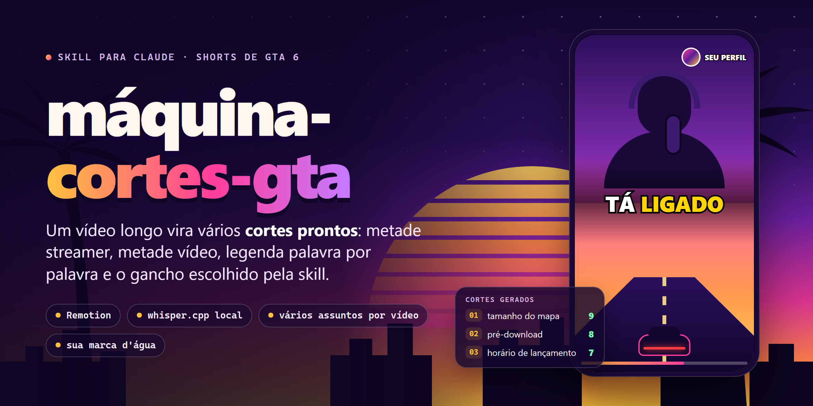

<p align="center">
  
</p>

<p align="center">
  <a href="LICENSE"></a>
  
  
  
  
</p>

# máquina-cortes-gta

A máquina-cortes-gta pega um vídeo longo (de um streamer ou de um podcast) e entrega **vários cortes prontos para Shorts sobre GTA 6**, cada um com um **assunto e um gancho diferentes**. Quem escolhe os trechos é a própria skill: ela transcreve o vídeo, lê a conversa, acha as frases que abrem uma curiosidade e corta cada uma até o payoff.

O visual é o de "metade streamer, metade vídeo": a pessoa em cima, gameplay ou trailer embaixo, legenda palavra por palavra na divisa, pausas cortadas, zoom a cada corte e a **marca d'água do seu perfil** (sua logo em círculo e o nome do perfil ao lado). A edição é feita em [Remotion](https://www.remotion.dev); a transcrição roda no seu computador, com [whisper.cpp](https://github.com/ggml-org/whisper.cpp).

**Exemplo de pedido:**

> /maquina-cortes-gta faz os cortes desse vídeo: https://www.youtube.com/watch?v=SEU_VIDEO

**Exemplo de resposta:**

> Gerei 4 cortes em `./cortes/podcast-gta6/`:
>
> | Corte | Assunto | Gancho | Duração | Nota |
> |---|---|---|---|---|
> | `01-tamanho-do-mapa.mp4` | tamanho do mapa | "O mapa do GTA 6 é a soma de três mapas." | 38 s | 9 |
> | `02-pre-download.mp4` | pré-download | "Seu console vai precisar de 212 GB livres." | 31 s | 8 |
> | `03-horario-de-lancamento.mp4` | horário de lançamento | "No Brasil, pode liberar à meia-noite." | 27 s | 7 |
> | `04-punicao-da-policia.mp4` | polícia | "A polícia agora lembra do seu carro." | 44 s | 7 |

(Exemplo ilustrativo do formato da resposta.)

## O que ele faz

| Você pede | A máquina-cortes-gta entrega |
|---|---|
| "faz cortes desse vídeo" (link ou arquivo) | De 3 a 5 cortes de 20 a 60 s, **cada um de um assunto diferente e com um gancho diferente**, escolhidos pela transcrição |
| (automático) | Legenda **palavra por palavra** na divisa, com a palavra falada em amarelo |
| (automático) | **Pausas longas removidas** e **cortes rápidos** (quebra a cada ~3 s, com zoom leve, flash e swoosh) |
| (opcional) | **Imagens do GTA aparecendo** (busca no Google pela API oficial, ou arquivos seus) com animação e pop |
| (opcional) | **Efeitos sonoros** (whoosh, impacto, pop) gerados com a ElevenLabs pela skill [sound-effects](THIRD_PARTY.md), que vem junto; usa créditos da sua conta |
| (automático) | Tela dividida: **streamer em cima, vídeo embaixo** (um trailer oficial do GTA VI ou o vídeo que você mandar) |
| (automático) | A **marca d'água do seu perfil** no canto superior direito de todos os cortes |
| "qual era o gancho de cada um?" | Tabela com o assunto, a frase de gancho, a duração, a nota e um título curto sugerido |

Cada corte sai em MP4 1080×1920, 30 fps.

## Instalação

Precisa do **Claude Code** (a skill roda comandos no seu computador) e de três programas que a instalação confere: **Node.js 18+** (de preferência 22+), **FFmpeg** e, para aceitar links, **yt-dlp**.

### Jeito mais fácil: peça pro Claude Code instalar

Abra o Claude Code e cole a mensagem abaixo. O Claude roda os comandos; você só aprova quando ele pedir permissão.

```text
Instala pra mim a skill maquina-cortes-gta: https://github.com/pedroxcardoso/maquina-cortes-gta

1. Rode `claude plugin marketplace add pedroxcardoso/maquina-cortes-gta` e depois
   `claude plugin install maquina-cortes-gta@maquina-cortes-gta`.
2. Confira se tenho Node.js 18+, FFmpeg e yt-dlp. Se faltar algum, me diga o comando
   para instalar no meu sistema.
3. Me avise para reiniciar o Claude Code. Na primeira vez que eu usar
   /maquina-cortes-gta, a skill instala o Remotion e o whisper.cpp sozinha.
```

### Claude Code: comandos

```bash
/plugin marketplace add pedroxcardoso/maquina-cortes-gta
```

```bash
/plugin install maquina-cortes-gta@maquina-cortes-gta
```

Reinicie o Claude Code se ele pedir. As dependências (Remotion, Chrome headless do Remotion e o whisper.cpp com o modelo `small`) são instaladas **na primeira vez que você usar a skill**, em `~/.maquina-cortes-gta`. São alguns minutos e cerca de 1 GB de download.

### Instalação manual (instala a skill e as dependências juntas)

```bash
git clone https://github.com/pedroxcardoso/maquina-cortes-gta.git
cd maquina-cortes-gta
```

Windows (PowerShell):

```powershell
powershell -ExecutionPolicy Bypass -File install.ps1
```

macOS, Linux ou Git Bash:

```bash
bash install.sh
```

O script copia a skill para `~/.claude/skills/maquina-cortes-gta` e roda o `setup.mjs`, que instala o motor (Remotion) e o whisper.cpp. Para só conferir o estado da instalação: `node ~/.claude/skills/maquina-cortes-gta/scripts/setup.mjs --check`.

## Primeiro uso: perfil e logo

Na primeira vez, a skill pede duas coisas, **só uma vez**:

1. o **nome do perfil** como deve aparecer na marca d'água (ex.: `SEU CANAL`);
2. a **logo**, que você anexa na conversa (PNG ou JPG, de preferência quadrada).

Ela guarda os dois em `~/.maquina-cortes-gta` e usa em todos os cortes. Para trocar depois, é só pedir: "troca minha logo".

Depois disso o fluxo é:

1. você manda o **vídeo de origem** (link ou arquivo) e, se quiser, o **vídeo da metade de baixo** (gameplay, trailer ou B-roll). Sem ele, a skill usa o trailer oficial da Rockstar;
2. a skill baixa, transcreve, escolhe os cortes e renderiza;
3. você recebe os MP4s e a tabela com o gancho de cada um.

## Como a skill escolhe os cortes

A skill lê a transcrição (palavras com tempo) e:

1. divide a conversa em **assuntos**;
2. escolhe **um corte por assunto**, sem repetir o mesmo gancho nem sobrepor trechos;
3. dá **nota de 0 a 10** ao gancho de cada um (lacuna de curiosidade, fato específico, conflito ou opinião forte, entrada direta, payoff dentro do corte, se entende sozinho);
4. **descarta** o que fica abaixo de 6 e começa cada corte exatamente na frase de gancho.

O guia completo está em [`references/ganchos.md`](skills/maquina-cortes-gta/references/ganchos.md).

## Como funciona

```
skills/maquina-cortes-gta/
├── SKILL.md                      o fluxo: perfil, vídeo, transcrição, escolha dos cortes, render
├── references/
│   ├── ganchos.md                como escolher cortes pelo gancho (notas, assuntos, início e fim)
│   ├── estilo-metade-metade.md   o layout, a legenda, o ritmo e o que dá para ajustar
│   └── problemas.md              erros comuns e como resolver
├── scripts/
│   └── setup.mjs                 instala e confere tudo; grava o perfil e a logo
└── template/                     o motor (copiado para ~/.maquina-cortes-gta/engine)
    ├── package.json              Remotion e whisper.cpp
    ├── scripts/
    │   ├── transcribe.mjs        áudio 16 kHz, whisper.cpp (palavra por palavra) e silêncios
    │   ├── transcript-text.mjs   a transcrição como "[mm:ss] frase", para a skill ler
    │   └── build.mjs             tira as pausas, refaz as legendas e renderiza cada corte
    └── src/
        ├── Root.jsx              a composição de 1080×1920
        └── SplitCut.jsx          metade de cima, metade de baixo, legenda, zoom e marca d'água
```

A skill (o Claude) decide **o que cortar**; os scripts fazem o trabalho pesado de forma determinística: transcrever, medir silêncios, remapear as legendas para a nova linha do tempo e renderizar.

## Limites (para não criar expectativa errada)

- **Roda no seu computador.** O primeiro render também baixa o Chrome headless do Remotion. No meu teste, 7 segundos de corte levaram cerca de 20 s para renderizar; um corte de 40 s deve levar alguns minutos (estimativa, depende do seu computador).
- **A skill escolhe pelo texto, não pela imagem.** Ela não vê o vídeo; o enquadramento do rosto é o padrão (`x` 50, `y` 35) e é ajustado quando ela olha um quadro. Se a pessoa estiver fora do centro, vale conferir.
- **Funciona melhor com uma pessoa falando em plano frontal.** Conversa com muita sobreposição de vozes gera legenda pior.
- **Qualidade da legenda** depende do modelo do whisper. O padrão é o `small`; para português mais exato use o `medium` (mais pesado).
- **Testado no Windows 11** (modelo `base`, vídeo de teste sintético). No macOS e no Linux o whisper.cpp é compilado na máquina e precisa de ferramentas de compilação; não testei.
- **O [Remotion](https://www.remotion.dev/license) tem licença própria**: confira se o seu uso (por exemplo, em empresa) exige licença.

## Aviso

Você é o responsável pelo vídeo que usa como origem e pelo que publica: direitos autorais, termos das plataformas e permissões de quem aparece nele.

## Privacidade

Tudo roda localmente: o vídeo, a transcrição e os cortes ficam no seu computador. A skill só acessa a internet para baixar o vídeo que você indicar, instalar as dependências e carregar a fonte da legenda (Google Fonts) na hora do render.

## Créditos

- [Remotion](https://www.remotion.dev), render dos vídeos.
- [whisper.cpp](https://github.com/ggml-org/whisper.cpp), por Georgi Gerganov, transcrição local (MIT).
- [FFmpeg](https://ffmpeg.org) e [yt-dlp](https://github.com/yt-dlp/yt-dlp).
- Skill e motor por [Pedro Cardoso](https://github.com/pedroxcardoso).

GTA e Grand Theft Auto são marcas da Rockstar Games / Take-Two Interactive. Este projeto é independente e não tem vínculo com elas.

## Licença

[MIT](LICENSE).
